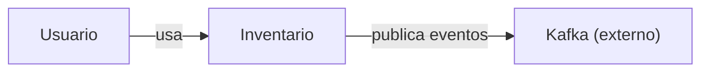
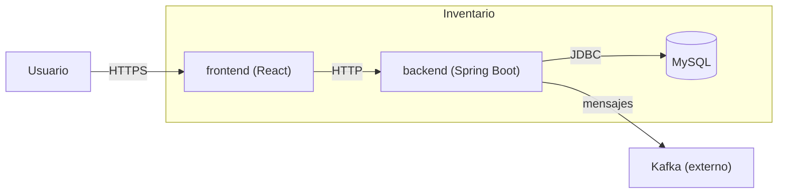

# Plantilla, reglas y presupuesto del README

Contrato compartido por quien redacta y quien verifica. El README se escribe en el idioma que eligió el usuario.

## Encabezados literales

Son literales, van en este orden y son los **únicos** de nivel 1 y 2, salvo las secciones previas conservadas por la regla 4 del Paso 1 de `SKILL.md`. Su ortografía no se corrige.

| Español | English |
|---|---|
| `# <Nombre real del proyecto>` | `# <Real project name>` |
| `## Pre requisitos del proyecto` | `## Project prerequisites` |
| `## Como arrancar el proyecto` | `## How to run the project` |
| `## Modulos del proyecto` | `## Project modules` |
| `## Archivos de configuracion para arrancar` | `## Configuration files to get started` |
| `## Practicas de pruebas` | `## Testing practices` |
| `## Como realizar una nueva implementacion` | `## How to implement a new feature` |
| `Cómo ejecutar las pruebas unitarias:` | `How to run the unit tests:` |
| `Con Docker:` | `With Docker:` |
| `Por terminal:` | `From the terminal:` |

Cabeceras de las dos tablas de configuración (4 columnas, en el idioma elegido):

| Tabla | Español | English |
|---|---|---|
| Archivos | `Archivo`, `Ubicación`, `Para qué sirve`, `Qué hacer con él` | `File`, `Location`, `Purpose`, `What to do with it` |
| Variables | `Archivo`, `Variable`, `Descripción`, `Valor default` | `File`, `Variable`, `Description`, `Default value` |

Frases fijas:

| Español | English |
|---|---|
| `versión no declarada en el código` | `version not declared in the code` |
| `(comando estándar; el proyecto no define uno propio)` | `(standard command; the project does not define its own)` |
| `El proyecto no requiere archivos de configuración para arrancar.` | `The project does not require configuration files to start.` |
| `El proyecto no tiene pruebas automatizadas.` | `The project has no automated tests.` |
| `definido (oculto)` | `set (hidden)` |
| `Contexto: quién usa el sistema y con qué sistemas externos se conecta.` | `Context: who uses the system and which external systems it talks to.` |
| `Contenedores: las partes desplegables del sistema y cómo se comunican.` | `Containers: the deployable parts of the system and how they communicate.` |

## Plantilla (ejemplo en español)

````markdown
# <Nombre real del proyecto>

<Resumen ejecutivo: 3 a 5 líneas. Qué problema resuelve, para quién y de qué tipo de sistema se trata (con su stack principal).>

## Pre requisitos del proyecto

<Lista corta: cada herramienta con su versión y el archivo del que sale.>

## Como arrancar el proyecto

Con Docker:

1. Prepara la configuración (ver "Archivos de configuracion para arrancar").
2. `docker compose up --build`, desde la raíz.
3. Abre `http://localhost:5173`.

Por terminal:

1. Prepara la configuración (ver "Archivos de configuracion para arrancar").
2. `mvn spring-boot:run`, desde `backend/`.

## Modulos del proyecto

Contexto: quién usa el sistema y con qué sistemas externos se conecta.



Contenedores: las partes desplegables del sistema y cómo se comunican.



<Una línea por módulo: nombre, responsabilidad y carpeta.>

## Archivos de configuracion para arrancar

| Archivo | Ubicación | Para qué sirve | Qué hacer con él |
|---|---|---|---|

| Archivo | Variable | Descripción | Valor default |
|---|---|---|---|

## Practicas de pruebas

<Tipos de prueba presentes y metodología (frameworks, qué se simula y qué se prueba contra servicios reales, dónde viven, convención de nombres, cobertura).>

Cómo ejecutar las pruebas unitarias:

<Comando exacto por módulo, con el directorio desde el que se lanza.>

## Como realizar una nueva implementacion

1. Crea la entidad en `backend/.../model/`, siguiendo `Producto`.
2. Expón el endpoint en `backend/.../controller/`, siguiendo `ProductoController`.
3. Añade las pruebas en `backend/src/test/`, con el sufijo `Test`.
4. Ejecuta `mvn test` desde `backend/`.
````

## Reglas de contenido

- **Resumen:** sin lenguaje de marketing; solo lo que el código demuestra.
- **Pre requisitos:** si el código no declara una versión, usa la frase fija `versión no declarada en el código`. Nunca la supongas.
- **Como arrancar:** dos vías, en este orden.
  - Si el proyecto tiene Docker (un `Dockerfile` o un docker compose), va primero `Con Docker:` y después `Por terminal:`. Sin Docker, solo `Por terminal:`.
  - Con compose, la vía Docker usa el compose (comando, servicios y puertos que define). Con solo `Dockerfile`, usa su construcción y ejecución, con el puerto de `EXPOSE` y las variables de `ENV`/`ARG`.
  - La vía terminal usa los comandos de los manifiestos y scripts de cada módulo, con el directorio desde el que se lanzan; si el proyecto no define el comando, usa el estándar de la herramienta con la frase fija.
  - Cada vía: pasos numerados de una línea; si hay archivos o variables por preparar, el primer paso remite a la sección de configuración; el último dice dónde queda disponible (URL o puerto) o cómo se usa el punto de entrada.
  - Un proyecto sin proceso que arrancar (librería, CLI) muestra en `Por terminal:` cómo instalarlo y un uso mínimo del punto de entrada.
- **Modulos:** dos diagramas, en este orden, cada uno precedido por su frase fija de leyenda. Siguen el modelo C4 (niveles 1 y 2); el README no nombra el modelo ni sus niveles (C4, C1, C2), eso queda solo aquí. Etiquetas siempre entre comillas para que el mermaid renderice; aristas con un verbo o protocolo breve, solo las que el código o la config evidencian.
  - *Contexto del sistema (nivel 1):* el sistema como un solo nodo con el nombre del proyecto; los actores humanos, solo si el código evidencia quién lo usa (interfaz web, roles, CLI); y los sistemas externos. Sin base de datos propia ni piezas internas.
  - *Contenedores (nivel 2):* un `subgraph` con el nombre del sistema que agrupa sus contenedores, cada uno como `nombre (tecnología)`. Actores y sistemas externos quedan fuera del `subgraph`. Un contenedor es una unidad ejecutable o desplegable (aplicación web, servicio, worker, base de datos propia), nunca una clase ni un paquete.
  - *Propio o externo:* es propio lo que el repositorio define (carpeta con manifiesto o Dockerfile, servicio del compose) y la base de datos que el sistema usa como almacenamiento propio. Es externo lo que solo se referencia por host, URL o configuración (APIs de terceros, brokers de mensajes, almacenamiento de objetos, SSO, correo).
  - Un proyecto de un solo contenedor grafica ese contenedor junto a sus externos. Sin evidencia de actores ni de externos, el nodo del sistema queda solo.
  - Bajo los diagramas, una línea por módulo (carpeta o paquete principal), no por clase.
- **Config:** dos tablas.
  - *Archivos:* una fila por archivo de configuración que exista (`.env`, `properties`/`yml`, env del frontend, Dockerfiles, docker compose). La categoría que no exista se omite; si no existe ninguna, usa la frase fija.
  - *Variables:* una fila por variable de entorno: placeholders `${VAR}` de properties/yml, variables de `.env*`, `ENV`/`ARG` de Dockerfile, `environment` del compose y las que el código lee directamente. Las claves fijas de properties/yml con valor literal no son filas: las cubre la tabla de archivos. Sin variables, se omite la tabla.
  - *Archivo:* donde la variable se define o se lee. Si aparece en varios archivos con el mismo default, todos van en la misma celda; si el default difiere, una fila por archivo.
  - *Descripción:* máx. 6 palabras, deducida del nombre y de dónde se usa.
  - *Valor default:* el que se aplica si la variable no se define (`${VAR:valor}`, `${VAR:-valor}`, `ENV VAR=valor`, valor de respaldo en el código); `—` si no hay. Los valores de ejemplo de `.env.example` no son defaults. Una variable secreta (clave, password, token, accesskey, secretkey) con default muestra la frase fija `definido (oculto)`; jamás su valor.
- **Pruebas:** clasifica por evidencia (unitarias, integración, e2e, otras) y nombra solo las que existan. El comando unitario sale del script o plugin del proyecto; si el proyecto no define uno, usa el estándar de la herramienta con la frase fija. Sin pruebas: frase fija y sin comandos.
- **Como realizar una nueva implementacion:** de 4 a 7 pasos numerados, uno por línea, que recorren las capas y convenciones que el código evidencia (por ejemplo controlador, servicio, repositorio y entidad; o módulo, exportación y prueba).
  - Cada paso nombra una carpeta o archivo real y cita como ejemplo un archivo existente de ese tipo.
  - El último paso ejecuta las pruebas y lo que el código exija antes de integrar (CI, linters, hooks), solo si el código lo declara.
  - Solo lo que el código muestra: sin nombres de ramas, mensajes de commit ni procesos de revisión, que el código no define.
- Problemas, inconsistencias o dudas detectados nunca van en el README: se reportan al usuario.

## Presupuesto de longitud

Meta: que una persona nueva lo lea completo en tres minutos.

| Parte | Tope |
|---|---|
| Resumen | 3 a 5 líneas |
| Cada ítem de pre requisitos, módulo o tipo de prueba | 1 línea (máx. 25 palabras) |
| Cada vía de arranque | máx. 6 pasos de 1 línea |
| Nueva implementación | 4 a 7 pasos de 1 línea (máx. 25 palabras) |
| Celda de la tabla de archivos | máx. 15 palabras |
| Fila de la tabla de variables | 1 línea; descripción máx. 6 palabras |
| Cada mermaid | máx. 12 líneas |
| README completo | máx. 150 líneas, más una por cada fila de la tabla de variables |

Prueba de las siete preguntas: cada línea debe responder una de estas, o se recorta.
1. ¿Qué es el proyecto? 2. ¿Qué necesito instalar? 3. ¿Cómo lo arranco? 4. ¿Cómo está organizado? 5. ¿Qué configuro para arrancar? 6. ¿Cómo lo pruebo? 7. ¿Cómo agrego algo nuevo?

Se recortan sin excepción: frases de introducción a una sección, marketing, repeticiones de lo dicho en otra sección y explicaciones de qué es una herramienta conocida.
