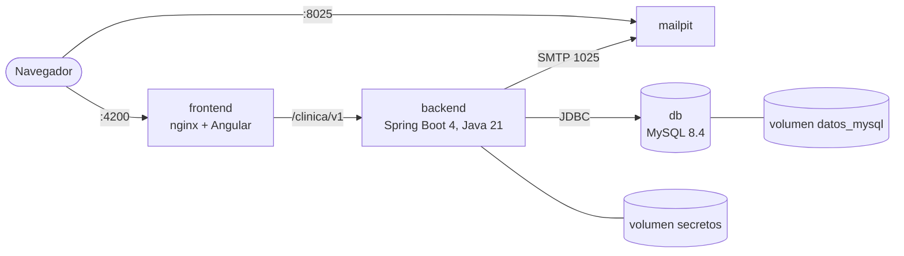
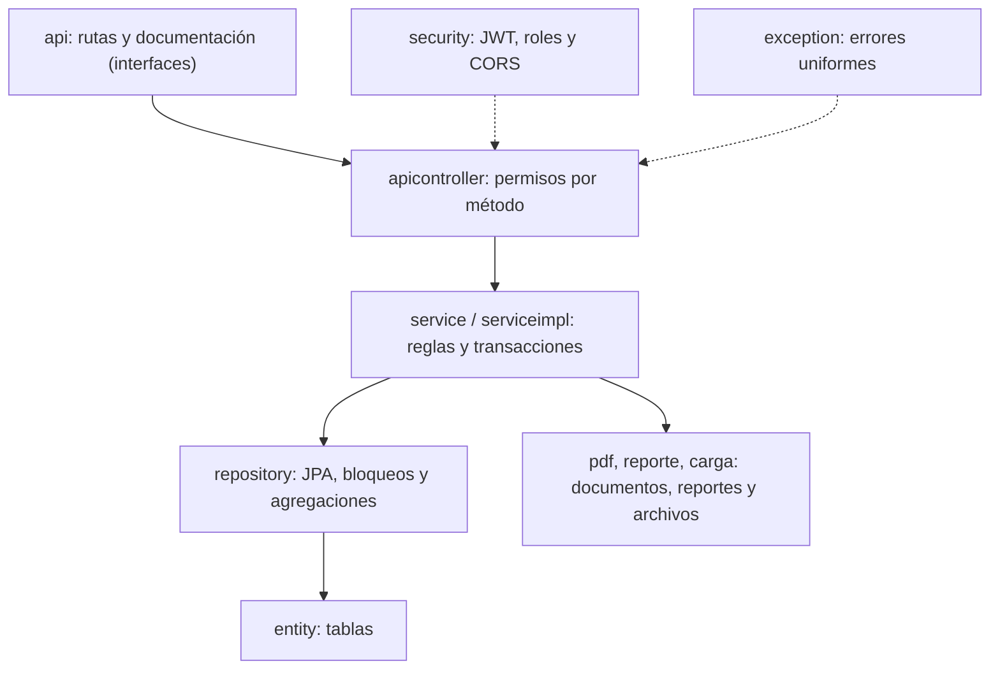
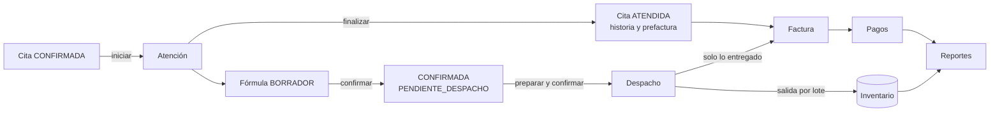

# Arquitectura

## Contenedores



nginx sirve Angular y reenvía `/clinica/v1` al backend, así el navegador usa un solo origen. La base guarda sus datos en un volumen de Docker y ejecuta `db/*.sql` solo la primera vez. Si no se define `DOCKER_JWT_SECRET`, el backend genera una clave y la conserva en el volumen `secretos`.

## Capas



| Paquete | Contenido |
|---|---|
| `api`, `apicontroller` | Contrato REST y controladores con `@PreAuthorize` |
| `service`, `serviceimpl` | Reglas de negocio |
| `repository`, `entity` | Persistencia |
| `models` | DTO de entrada (`Rq`) y salida (`Rs`) |
| `security` | Filtro JWT, roles, usuario actual y CORS |
| `carga` | Lectura, validación e importación de archivos |
| `reporte` | Catálogo de reportes y exportadores |
| `pdf` | Fórmula, prefactura, comprobante y factura |
| `exception` | Formato único de errores |
| `config`, `util` | OpenAPI, JSON, correo asíncrono y utilidades |

Servicios compartidos que concentran una responsabilidad: `AgendaService` (ocupar la agenda), `ExistenciasService` (único que cambia cantidades) y `ConfiguracionService` (consecutivos).

## Autenticación

```mermaid
sequenceDiagram
    actor U as Usuario
    participant F as Frontend
    participant B as Backend
    participant M as Correo
    U->>F: usuario y contraseña
    F->>B: POST /auth/login
    B->>B: BCrypt; genera OTP (15 min, un solo uso)
    B->>M: envía OTP
    U->>F: OTP
    F->>B: POST /auth/validate-token
    B-->>F: JWT HS512 (1 h) con rol, menús, medicoId y jti
    F->>B: petición con Authorization: Bearer
    B->>B: firma, sesión activa, usuario activo y rol vigente
    F->>B: POST /auth/cerrar-sesion
    B->>B: la sesión del jti queda inactiva (401 desde ahí)
```

## De la cita al pago



## Transacciones y concurrencia

- Se bloquea siempre en el mismo orden para no interbloquear: médico → mascota; fórmula → despacho → productos → lotes; cita → fórmulas → consecutivos.
- Aislamiento `READ_COMMITTED` en las operaciones que leen después de bloquear.
- `@Version` en las entidades que se editan; un choque responde 409.
- La base también lo impide: columnas generadas únicas para factura vigente, tarifa activa, despacho en preparación y entrega facturada.
- La carga masiva usa una transacción por fila.
